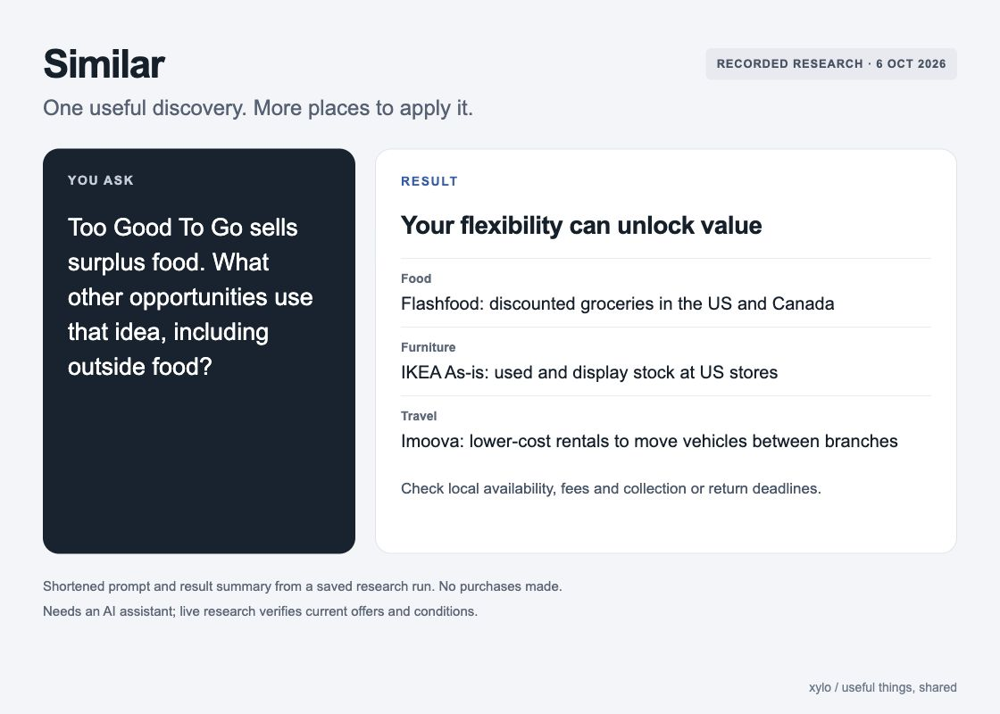

# Similar: prompt and result

**Summary of a recorded research run from 6 October 2026.** The picture shortens the original prompt and summarises selected findings. It is a designed explanation, not a screenshot of the chat. No purchases or bookings were made.

## Original prompt

> Too Good To Go sells surprise bags of surplus food. Use Similar to find other useful opportunities from that idea, including outside food. I am flexible about timing, but explain simply and tell me where each opportunity is available.

## Result summary

The run found a useful connection: **accepting a constraint can solve someone else’s problem and reduce your cost.**

| Finding | Why it connects | Important condition |
| --- | --- | --- |
| Flashfood groceries | Buy food a shop needs to sell soon. | Participating stores in the US and Canada; collection deadlines and fees apply. |
| IKEA As-is furniture | Accept used or display stock a shop needs to clear. | The recorded check covered participating US stores; inspect the item and check local terms. |
| Imoova vehicle rentals | Move a car or campervan to the branch where it is needed. | Routes and dates are limited; fees, fuel, deposits and return deadlines matter. |

The original response also covered Olio and TKTS theatre tickets. These findings describe opportunities, not achieved savings. Availability, eligibility and terms may have changed since the run.

[Read the complete saved response and its sources](examples/surplus-opportunities.md) · [See the libraries example](examples/libraries-singapore.md)

## What you need

An AI assistant and a topic or discovery. Live research is needed to check current offers and conditions. Computer control is not required. You can give the assistant [the instructions](SKILL.md) without installing anything; the `$similar` shortcut is for an installed skill.

[Setup and instructions](README.md#use-without-installing) · [Evaluation record](EVALUATION.md)
