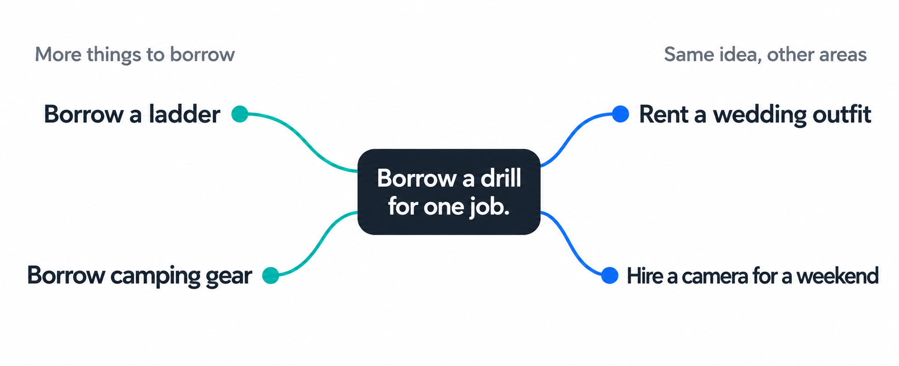

# Similar

**Found something useful? Find out where else the idea could work.**

I made Similar for those moments when you think, “What else could I do with this?” Give your AI a useful discovery or a topic, and it finds more opportunities worth exploring.

**[Download the skill](https://github.com/xyloshin/similar/releases/download/v0.1.0-beta.4/similar-release.zip)** · Free · One AI assistant · Public beta



*Illustrative ideas. Local availability and costs vary.*

## Try it

Give your AI [SKILL.md](SKILL.md), then ask:

```text
Use Similar on this: I can borrow a drill instead of buying one.
Where else could that idea help me?
```

Add your location, budget, or anything else that matters.

## Install in Codex

[Download and extract the ZIP](https://github.com/xyloshin/similar/releases/download/v0.1.0-beta.4/similar-release.zip). Put the `similar` folder in `~/.codex/skills`, then use `$similar` followed by your topic.

<details>
<summary>How it chooses useful ideas</summary>

Similar looks for more ways to get the same benefit and places outside that area where the underlying idea could help. It explores obvious options, less obvious approaches, and opportunities that depend on particular access.

It weighs the benefit against the effort, cost, and your circumstances. Each finding explains the gain, the catch, and a practical next step, with sources where needed. There’s no fixed number or split, and weak ideas don’t get added to fill a list.

</details>

<details>
<summary>Setup and beta notes</summary>

Similar is a set of instructions for your current AI assistant. Live search or browsing is needed to check current offers and conditions. Without it, the assistant should say what still needs checking. It doesn’t make purchases, contact people, or change accounts.

For Codex, the file should end up at `~/.codex/skills/similar/SKILL.md`. If you’ve configured `$CODEX_HOME`, use its `skills` folder instead. Already have a skill called `similar`? Keep your copy and try this one in a separate environment.

This is beta 0.1.0-beta.4. The [two recorded examples](EXAMPLES.md) are from an earlier version, not guaranteed results or proof that it beats an ordinary prompt. The latest instruction changes haven’t had a fresh research run or clean-install test, and other AI apps haven’t been tested. See the [evaluation notes](EVALUATION.md).

</details>

Found something useful? [I’d like to hear about it](https://github.com/xyloshin/similar/issues). Please leave out private details.

[MIT License](LICENSE) · Free to use and adapt.
